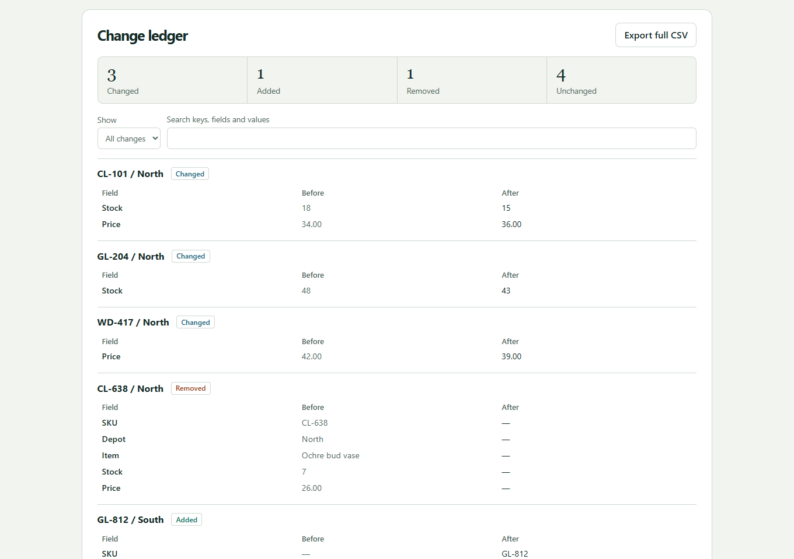

# TallyRill

Compare two CSV or TSV snapshots on your own computer. Match rows by one or several columns, review changed fields, and save a CSV for the person who needs to act on it. Available in English and Russian. MIT licensed.



[Open TallyRill in your browser](https://ltfs229-ag.github.io/TallyRill/) · [Download for Windows](https://github.com/ltfs229-ag/TallyRill/releases/tag/v1.0.0) · [Руководство на русском](docs/GUIDE.md#русское-руководство)

## Try the warehouse example

Open `TallyRill.html` from the portable ZIP in a current version of Microsoft Edge or Google Chrome. The Windows MSI adds a Start menu shortcut for the current user. Select **Open warehouse example**. A SKU can occur at two depots, so this comparison uses **SKU + Depot**. Search for **CL-101** to see North stock fall from 18 to 15 and its unit price change from 34.00 to 36.00.

For your own exports, choose the earlier and later files, select their shared key columns, then click **Compare files**. Each field stays text, including leading zeros. Duplicate or missing keys produce a record-level diagnostic. Reordered rows and columns compare by key and heading. New or missing columns appear in a separate schema summary.

The downloadable HTML works offline. Processing runs in a browser worker. Each file can contain up to 12 MiB, 500,000 cells including headings and 256 columns. The full CSV export includes changed fields and all fields of added or removed records. Spreadsheet formula-like values acquire a leading apostrophe. The unsigned MSI targets Windows 10/11 with a current browser. Installation was tested on Windows 11.

[Bilingual user guide](docs/GUIDE.md) · [Privacy](PRIVACY.md) · [QA and measurements](QA_REPORT.md) · [Comparison with daff](docs/COMPARISON.md)

## Собственная сверка

Откройте portable-файл `TallyRill.html` в Edge или Chrome либо установите MSI и запустите TallyRill из меню «Пуск». Кнопка **Русский** переключает язык. Выберите две выгрузки, укажите один или несколько столбцов ключа и нажмите **Сравнить файлы**. Для CSV из старых учётных систем доступна кодировка Windows-1251. Отчёт содержит старые и новые значения, добавленные и удалённые позиции. Руководство, синтетические примеры и лицензия входят в обе поставки.

[Запустить в браузере](https://ltfs229-ag.github.io/TallyRill/) · [Тёмная тема](media/report-dark-ru.png) · [Установка и удаление](docs/PACKAGING.md)

### Install with Scoop

With Scoop installed, use the manifest from the versioned source. It downloads the portable ZIP from GitHub Releases and creates a TallyRill shortcut.

```powershell
scoop install https://raw.githubusercontent.com/ltfs229-ag/TallyRill/v1.0.0/distribution/scoop/tallyrill.json
```

## Build and verify

From the source directory, run the following in PowerShell. Building the HTML needs Python 3.10 or newer. Building the MSI uses Windows CPython 3.12 and its standard msilib module. The application ships with zero third-party runtime packages.

```powershell
py -3.12 scripts/build.py
node --test tests/engine.test.js
py -3.12 scripts/package.py
Get-Content release/SHA256SUMS.txt
```

To run the browser suite, install Playwright 1.56.0 and psutil 7.1.3 in a development virtual environment and run `python tests/browser.py`. Set `TALLYRILL_BROWSER` to an installed Chromium-family browser executable to override the Edge default. To reproduce screenshots and video use `python scripts/capture.py` with FFmpeg on PATH. To build the website locally, run the capture script before running `python scripts/site.py` so the website has a demonstration recording.

## Report an issue

Use the [bug report form](https://github.com/ltfs229-ag/TallyRill/issues/new?template=bug.yml). Include the version, browser, selected columns, expected and observed counts, and a minimal invented example. Keep company exports, personal records, full file paths and credentials out of public reports. A copy of the report form is included in the source tree.

[License](LICENSE) · [Release notes](CHANGELOG.md) · [Architecture](ARCHITECTURE.md) · [Roadmap](ROADMAP.md)

