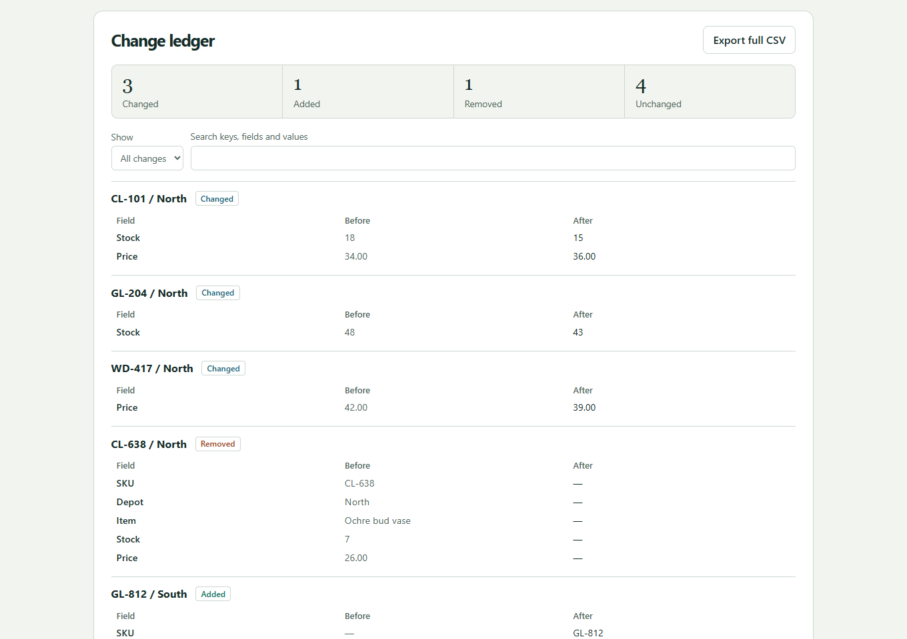

# Two CSVs, eight rows each, five inventory records to investigate

Both warehouse exports contain eight rows. A row-count check passes. A line-by-line diff lights up because the second export arrived in a different order. Neither result tells the person responsible for inventory which price to check or which item disappeared. The missing piece is the identity of a stock position.

## What identifies one record?

In the sample files shipped with TallyRill, SKU CL-101 names a porcelain pour-over held at two depots. The earlier file lists North first. The later file lists South first. A lookup that keeps only the first row per SKU can compare North’s 18 units with South’s 12 and report a six-unit drop. Following the same depot across both files gives a different answer.

| Key | Previous stock | Current stock | Previous price | Current price |
| --- | --- | --- | --- | --- |
| CL-101 / North | 18 | 15 | 34.00 | 36.00 |
| CL-101 / South | 12 | 12 | 34.00 | 34.00 |

Here the pair (SKU, Depot) identifies one stock position. Stock and Price are attributes of that position. Adding Price to the key would change the meaning of the comparison. A price change would make the old key disappear and a new one appear. Choose columns that you expect to remain stable over the life of a record.

## Reproduce the result

Open [TallyRill](https://ltfs229-ag.github.io/TallyRill/) and choose **Open warehouse example**. It loads the two synthetic exports and selects both key columns. To test the assumption yourself, load the [sample CSVs](https://github.com/ltfs229-ag/TallyRill/tree/v1.0.0/examples) manually and try SKU alone. TallyRill reports the duplicate. Add Depot, rerun, then search for **CL-101**.

*North has two field changes. South contributes an unchanged match. The counter counts records.*

The other two modified records account for one field each. GL-204 at North went from 48 units to 43. WD-417 at North kept its quantity but changed price from 42.00 to 39.00. One vase disappeared and one carafe appeared. That is how two files of equal length produce five records worth investigating.

## Why the exported report has 14 rows

The ledger groups changes by record. The CSV export has a different unit of detail. It emits four rows for the four changed fields and five fields apiece for the added and removed records. Four plus five plus five gives 14 data rows. The export always includes the full comparison, even if the current view is filtered to one SKU.

For an independent check, the project ran daff on the same files with both identifiers and unordered matching. Its output contains the same old and new values, including the untouched South position’s absence from the changes. The exact command and captured output are in the [comparison notes](https://github.com/ltfs229-ag/TallyRill/blob/v1.0.0/docs/COMPARISON.md).

## Where exact matching helps and where it costs

TallyRill preserves text, so a part number such as 007 retains its leading zeros. The same choice makes 34.0 and 34.00 different prices in the report. If the business treats those representations as equivalent, normalize the price column before comparing while leaving identifier columns intact. A blank or duplicated key needs attention before the result can be trusted.

The application processes files in the browser. For disconnected machines, the [portable release](https://github.com/ltfs229-ag/TallyRill/releases/tag/v1.0.0) contains the complete HTML, sample files and guide. Extract it and open TallyRill.html in Edge or Chrome. Each input can hold up to 12 MiB, 500,000 cells including the header, and 256 columns. Larger files fall outside this version’s supported range.

*This project walkthrough was written with AI assistance. The data, screenshot and comparison output come from the public TallyRill 1.0.0 release.*
