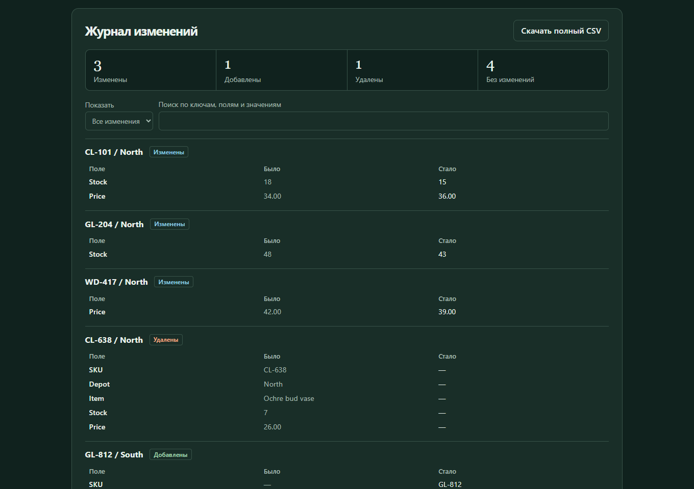

# Вчера 18 штук, сегодня 15. Как сверить две складские выгрузки в TallyRill

В двух учебных CSV по восемь строк. Ассортимент вроде бы прежний, но из новой выгрузки исчезла ваза, появился графин, а у кофейной воронки изменились и остаток, и цена. Все три события можно пропустить, если сверять только число строк или искать товар по одному артикулу.

## Один артикул живёт на двух складах

У фарфоровой воронки артикул CL-101. В старой выгрузке на складе North числятся 18 штук, на South — 12. В новой выгрузке строки переставлены, и первой встречается южная. Если подставить первое найденное совпадение по артикулу, к северным 18 можно ошибочно приписать южные 12. Получится недостача в шесть штук, которой в примере нет.

| Склад | Остаток вчера | Остаток сегодня | Цена вчера | Цена сегодня |
| --- | --- | --- | --- | --- |
| North | 18 | 15 | 34.00 | 36.00 |
| South | 12 | 12 | 34.00 | 34.00 |

У каждой строки есть адрес из двух частей — артикул и склад. Когда обе части совпали, можно сравнивать цену и остаток. Поэтому сортировка строк на результат не влияет. Если пара повторяется, TallyRill укажет на неоднозначный ключ. Такое бывает, например, когда остатки внутри склада ведут ещё и по партиям.

## Где искать расхождение

Откройте [TallyRill](https://ltfs229-ag.github.io/TallyRill/) и нажмите **«Открыть складской пример»**. В примере уже выбраны два столбца ключа, **SKU** и **Depot**. Журнал покажет три изменённые позиции, одну новую, одну исчезнувшую и четыре без изменений. Введите **CL-101** в поиск. Останется карточка северного склада с двумя строками, Stock и Price.

*Две правки в одной карточке учитываются как одна изменённая позиция.*

Очистите поиск и выберите удалённые позиции. В журнале появится ваза CL-638 с прежним остатком 7. Это означает, что пары CL-638 и North больше нет в файле. Чтобы решить, распродали товар, переместили его или исключили из отчёта, понадобится документ движения либо информация о настройках выгрузки.

## Что получит коллега

Кнопка **«Скачать полный CSV»** сохраняет весь журнал даже при активном поиске. На экране может оставаться одна воронка, а в файле будет 14 строк данных. Четыре описывают изменившиеся поля. Ещё по пять строк приходится на все поля исчезнувшей вазы и нового графина. Это важно, если вы собирались переслать только отфильтрованную позицию.

## Как повторить со своими файлами

В первую область выберите более ранний CSV или TSV, во вторую — более поздний. Укажите столбцы, по которым можно однозначно узнать позицию, и нажмите **«Сравнить файлы»**. Если старая учётная система выгрузила кириллицу в Windows-1251, в настройках чтения этого файла можно выбрать кодировку вручную.

Значения сравниваются как текст. Артикулы 007 и 7 останутся разными, и смена записи цены с 34.0 на 34.00 тоже попадёт в журнал. Когда это просто смена формата отчёта, приведите обе выгрузки к одному формату до сверки. Для работы без сети скачайте portable ZIP, распакуйте его и откройте TallyRill.html в браузере. Содержимое таблиц обрабатывается на устройстве. [Сборка и контрольные суммы](https://github.com/ltfs229-ag/TallyRill/releases/tag/v1.0.0) · [Оба учебных CSV](https://github.com/ltfs229-ag/TallyRill/tree/v1.0.0/examples)

*Материал проекта TallyRill подготовлен с помощью ИИ. Цифры и скриншот взяты из открытого учебного примера версии 1.0.0.*
